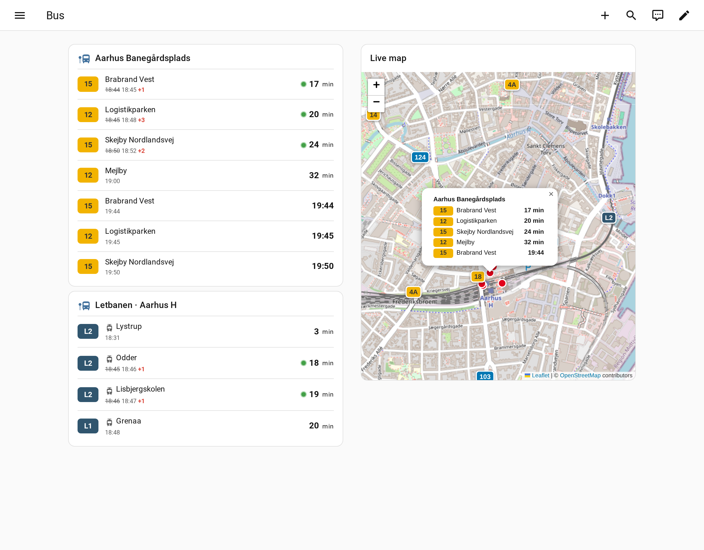
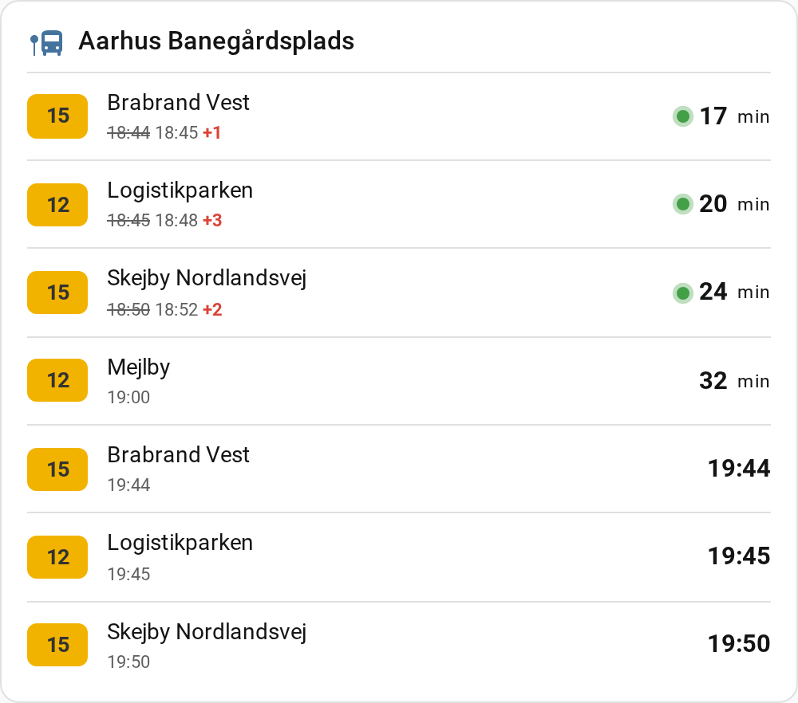
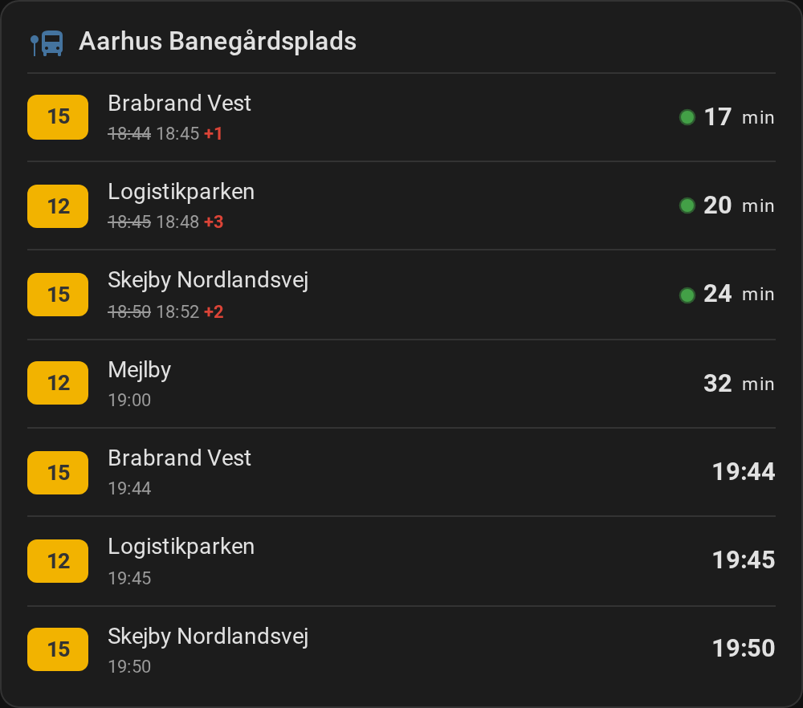
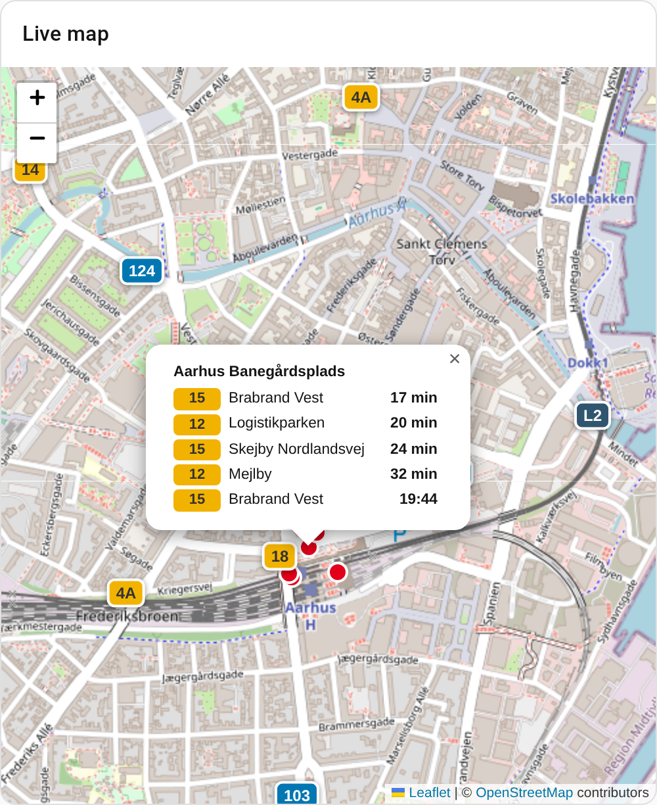
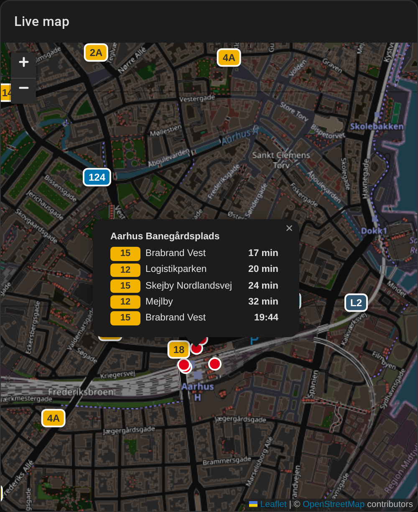
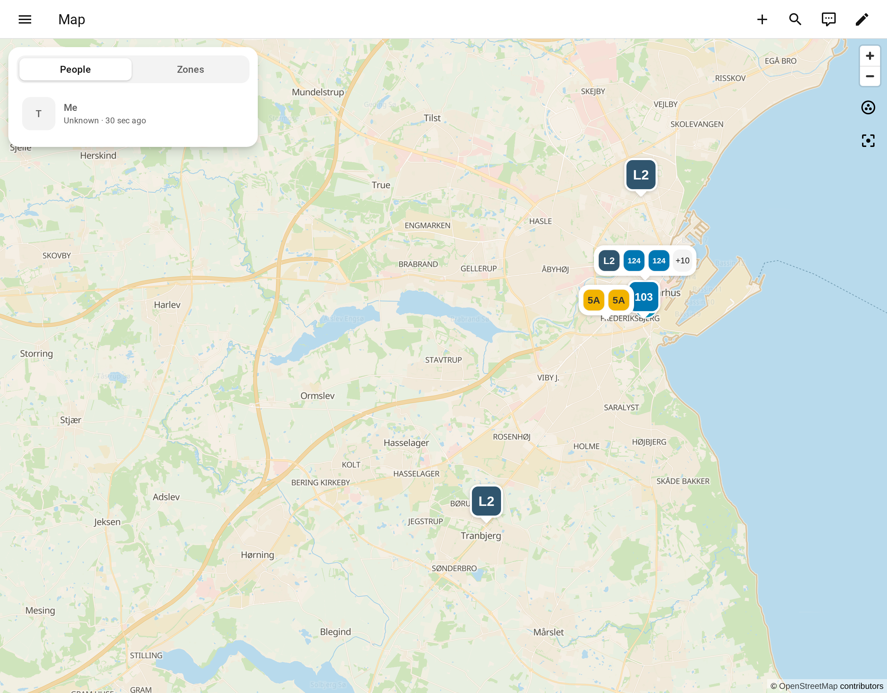

<h1 align="center">🚌 Midttrafik Live for Home Assistant</h1>

<p align="center">
  <b>Real-time buses and light rail (Letbanen) in Aarhus and Central Denmark, right in your Home Assistant dashboard.</b><br>
  Live departure boards · moving vehicles on a map · delays and cancellations · automations
</p>

<p align="center">
  <a href="https://hacs.xyz"></a>
  <a href="https://www.home-assistant.io"></a>
  
  
  <a href="LICENSE"></a>
</p>

<p align="center">
  <picture>
    <source media="(prefers-color-scheme: dark)" srcset="docs/images/dashboard-dark.png">
    
  </picture>
</p>

## ✨ Why you'll like it

- **Know when to leave.** Live countdowns to the next bus or tram, with delays (`+3`) and cancellations shown clearly.
- **See every bus moving.** A live map with vehicles drawn in Midttrafik's own line colours. Click a stop to see its next departures.
- **Two custom cards included and loaded automatically.** No extra downloads and no manual dashboard resources.
- **Set up in the UI.** Search for a stop or line by name, or pick a stop near your home. No YAML and no stop IDs to look up.
- **Built for automations.** Timestamp sensors, a vehicle count, and actions that return data for scripts.
- **No account or API key.** Map tiles come from OpenStreetMap. Light and dark mode are both supported.
- **Includes a Danish translation.** 🇩🇰

## 🖼️ The cards

### Departure board: `custom:midttrafik-departures-card`

<table>
  <tr>
    <td></td>
    <td></td>
  </tr>
</table>

- Line badges in the official Midttrafik colours, with a tram icon for Letbanen.
- Countdown in minutes; departures more than an hour away show the clock time.
- 🟢 A pulsing dot marks a live time from the vehicle, as opposed to a scheduled one.
- Late departures show the old time crossed out next to the new one, plus the delay (e.g. `+2`).
- Cancelled departures are struck through and marked *Aflyst / Cancelled*.

### Live map: `custom:midttrafik-map-card`

<table>
  <tr>
    <td></td>
    <td></td>
  </tr>
</table>

- Every bus and tram you follow, moving smoothly between updates.
- Your stops appear as red dots; click one for its next departures.
- Follows your theme's light or dark mode automatically.

### Home Assistant's built-in map

Vehicles are also `geo_location` entities, so they appear on HA's own **Map**
page as coloured line badges, with no card needed.

<p align="center"></p>

## 📊 Available data

Add the integration once for each thing you want to follow. Three kinds are available:

| Follow… | Example | You get |
|---|---|---|
| 🚏 **A stop** | *Aarhus Banegårdsplads* | Departure board with live times, delays and cancellations |
| 🚋 **A line** | *L2 → Lisbjergskolen*, *4A → Brabrand Nord* | Live position of every vehicle on that line and direction |
| 📍 **An area** | A 1 km circle around your home | Live position of every bus and tram inside it |

### Entities

| Entity | State | Attributes |
|---|---|---|
| `sensor.<stop>_upcoming_departures` | Number of upcoming departures | `departures`: the full list (used by the cards); `stops`: platforms with coordinates |
| `sensor.<stop>_departure_1` … `_10` | **Timestamp** of the Nth departure | `line`, `direction`, `final_stop`, `scheduled`, `expected`, `delay_minutes`, `realtime`, `cancelled`, `light_rail`, `color`, `journey_ref`, `bus_id` |
| `sensor.<line or area>_vehicles` | Number of vehicles right now | `vehicles`: id, line, direction, latitude/longitude, colours |
| `geo_location.<line>_<direction>` | Distance from home (km) | One entity per moving vehicle; added and removed automatically |

Departure sensor 1 is enabled by default. Enable more on the device page.

### Per departure

| Field | Example |
|---|---|
| Line and destination | `15` → `Brabrand Vest` |
| Scheduled and expected time | `18:44` → `18:46` |
| Delay | `2` minutes |
| Live vs. scheduled | `realtime: true` |
| Cancelled | `cancelled: false` |
| Bus or Letbane | `light_rail: false` |
| Line colours | `#F2B300` / `#000` |
| Full trip | via the `get_journey` action |

### Actions (for scripts and automations)

| Action | What it returns |
|---|---|
| `midttrafik_live.get_departures` | Departures from **any** stop, optionally from a future time |
| `midttrafik_live.get_journey` | Every stop on a trip, with scheduled and live times |
| `midttrafik_live.search` | Stops and lines matching a name or line number |

## 📦 Installation

### HACS (recommended)

1. In HACS, open the menu (⋮) and choose **Custom repositories**.
2. Add `https://github.com/naueramant/home-assistant-midttrafik-live` with type **Integration**.
3. Search for **Midttrafik Live**, install it, and restart Home Assistant.

### Manual

Copy `custom_components/midttrafik_live` into your Home Assistant
`config/custom_components/` folder and restart.

## ⚙️ Setup

**Settings → Devices & services → Add integration → Midttrafik Live**, then choose:

- **Departures from a stop:** type a name (e.g. *Banegårdsplads*), or leave the field empty to list stops near your home. Choose the whole stop (all platforms and both directions) or a single platform.
- **Live vehicles on a line:** type a line number (e.g. *L2*, *4A*) and choose a direction.
- **Live vehicles in an area:** draw a circle on the map. It's centred on your home by default.

Each entry's **Configure** dialog has:

| Option | Default |
|---|---|
| Update interval | 60 s for stops, 20 s for vehicles |
| Number of departure sensors | 3 |
| Only these lines | All lines |

## 🃏 Card configuration

Both cards have a visual editor: **Edit dashboard → Add card → search "Midttrafik"**.

```yaml
type: custom:midttrafik-departures-card
entity: sensor.aarhus_banegardsplads_upcoming_departures
max_departures: 6        # optional, default 6
show_scheduled: true     # optional: scheduled time, with the delay when late
title: To the city       # optional: defaults to the stop name
```

```yaml
type: custom:midttrafik-map-card
title: Live map
height: 450                    # px
entities:                      # optional: defaults to all Midttrafik vehicle and stop sensors
  - sensor.l2_lisbjergskolen_vehicles
  - sensor.near_home_vehicles
  - sensor.aarhus_banegardsplads_upcoming_departures   # draws the stop; click it for departures
zoom: 15                       # optional
center: [56.1525, 10.2045]     # optional: otherwise fits all markers
show_home: true
dark_mode: auto                # auto | light | dark
tile_url: https://tile.openstreetmap.org/{z}/{x}/{y}.png   # optional: another tile provider
```

> If your dashboards manage resources in YAML mode, add
> `/midttrafik_live/midttrafik-live-card.js` as a `module` resource yourself.

## 🤖 Automation ideas

**Notify me 5 minutes before the bus leaves:**

```yaml
triggers:
  - trigger: template
    value_template: >
      {{ ((as_timestamp(states('sensor.aarhus_banegardsplads_departure_1'), 0)
          - now().timestamp()) / 60) | round(0) == 5 }}
actions:
  - action: notify.mobile_app_phone
    data:
      message: >
        Bus {{ state_attr('sensor.aarhus_banegardsplads_departure_1', 'line') }} to
        {{ state_attr('sensor.aarhus_banegardsplads_departure_1', 'direction') }} leaves in 5 minutes
```

**Turn the hallway light red when the next bus is cancelled:**

```yaml
triggers:
  - trigger: state
    entity_id: sensor.aarhus_banegardsplads_departure_1
    attribute: cancelled
    to: true
actions:
  - action: light.turn_on
    target:
      entity_id: light.hallway
    data:
      color_name: red
```

**Get tomorrow morning's departures in a script:**

```yaml
action: midttrafik_live.get_departures
data:
  stop_number: "751001602"
  at: "2026-10-19 08:00:00"
response_variable: result
```

## 🐍 Python SDK

The integration is built on a small async client that is also usable on its own:

```bash
pip install git+https://github.com/naueramant/home-assistant-midttrafik-live
```

```python
import asyncio
from midttrafik_live import MidttrafikLiveClient

async def main():
    async with MidttrafikLiveClient() as client:
        for d in await client.get_departures("751001602"):
            print(d.expected.strftime("%H:%M"), d.line, d.direction, f"+{d.delay_minutes}")

asyncio.run(main())
```

It covers nearby stops, departures, trip details, live vehicle positions (by
area or by line), search and seat occupancy. See [`example.py`](example.py).

## 🗂️ Repository layout

```
custom_components/midttrafik_live/
├── api/            # Python SDK (also the pip package `midttrafik_live`)
├── frontend/       # Lovelace cards, registered automatically
├── translations/   # English and Danish
└── *.py            # the integration
```

The SDK has one copy, in `custom_components/midttrafik_live/api/`. Home Assistant
imports it from there, and `pyproject.toml` builds the pip package from the same folder.

## ⚠️ Disclaimer

This is an unofficial community project. It is not affiliated with or endorsed
by Midttrafik. It uses the same public API as the *Midttrafik Live* app, which
can change without notice. Please keep update intervals reasonable.

## 📄 License

[MIT](LICENSE) © 2026 Jonas Tranberg
